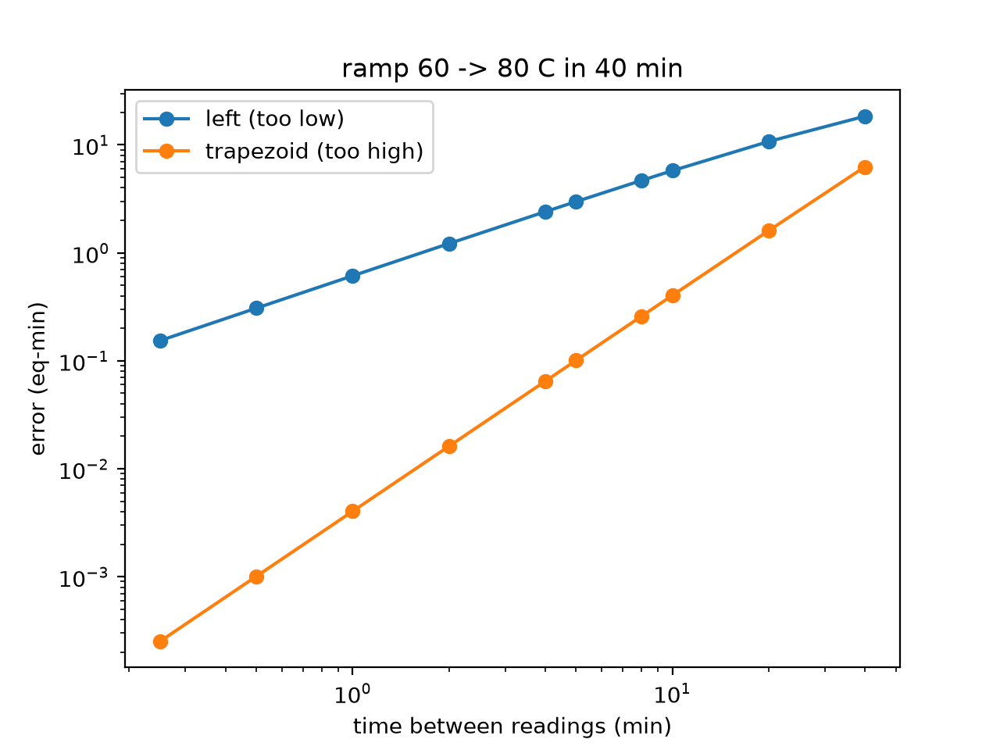
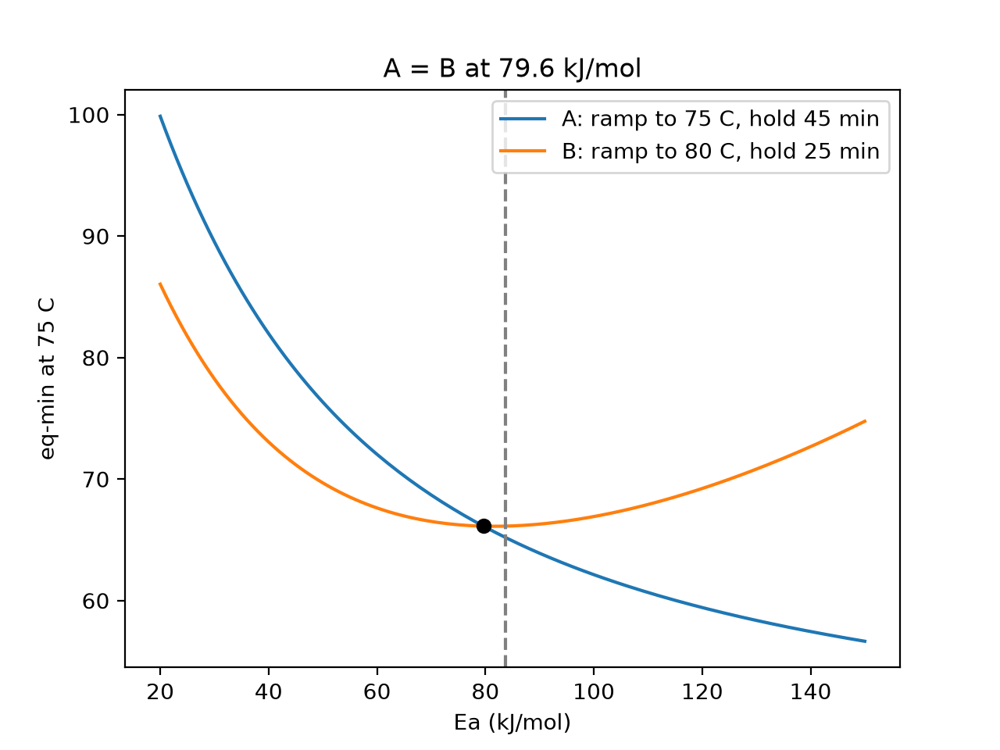

# cbd-thermal-budget

Equivalent deposition time for my CdS chemical bath deposition (CBD) runs.
(used ai in readme files and some png and some of missing data)
The bath never stays at one temperature. It needs more than an hour to warm up, then overshoots and drifts, so "60 min at 75 °C" is not the same thing in two runs. This takes the temperature log of a run and turns it into equivalent minutes at 75 °C, so runs can be compared and I know when to take the substrate out.

## Method

Growth is Arrhenius, so one minute at T counts as

$$c(T) = \exp\left[\frac{E_a}{R}\left(\frac{1}{T_{ref}} - \frac{1}{T}\right)\right]$$

minutes at T_ref = 75 °C (T in K). The budget of a run is B = ∫ c(T) dt, in eq-min. It's the same idea as the equivalent age in the maturity method for concrete (ASTM C1074).

- Ea = 83.7 kJ/mol (Ortega-Borges & Lincot report ~85)
- target = 60 eq-min (Ouachtari et al.: 75 °C, 60 min and [S]/[Cd] = 2.5 is the optimum, after 60 min the (002) peak gets weaker)

`budget.py` has four ways to integrate between readings: `left`, `right`, `trapezoid` (default) and `linear_T` (T linear between readings, c integrated with quad). c is convex, so trapezoid always comes out a bit above linear_T, and the error drops about 4x when the time step is halved. With `Tmin=50` only the time above 50 °C counts.



`check_log` in `logio.py` only marks rows, it doesn't delete anything: same or backwards times, T outside 10-100 °C, heating faster than 1.5 °C/min or cooling faster than 0.5 °C/min. The bath can't really do that (passive cooling is ~0.08 °C/min), so it's usually the probe, stirring or the hot plate.

## Stop time

If the bath is already at its plateau, time left = (target - B) / c(T). E.g. B = 53.4 at 75.9 °C gives 6.1 more minutes for 60 eq-min, 10.8 for 65.

Before the plateau the bath is modeled as first order with dead time (τ = 31 min, θ = 6 min, fitted on one heating ramp and checked on another) and `stop_time` solves B(t) = target. From 60 °C towards 76 °C it says 87.9 min (83.5 with θ = 0). `fit_bath` fits τ, θ and T∞ to heating ramps.

## Ea sensitivity

We didn't measure Ea ourselves, so `sensitivity.py` checks if comparisons between runs still hold with a different Ea.

- 60 min at 75 °C and 50 min at 78 °C are equal at Ea = R ln(60/50) / (1/T_A - 1/T_B) = 61.8 kJ/mol.
- Made up runs: A goes 25 → 75 °C in 90 min and holds 45 min, B goes 25 → 80 °C in 90 min and holds 25 min. They cross at 79.6 kJ/mol. At 83.7 B is a bit ahead (66.1 vs 65.2 eq-min) but 4 kJ/mol lower A is ahead, so "B got more deposition" can't really be said.
- B is not monotonic in Ea. The cold ramp counts less as Ea grows but the time above 75 °C counts more.
- With Tmin = 50, A loses 2.7 % of its budget at 83.7 kJ/mol but 10.9 % at 40 kJ/mol. With a low Ea the threshold matters a lot.
- c is convex, so wiggling ±2 °C around 75 averages to 1.013. One minute at 73 °C loses 0.154 eq-min, one at 77 °C gains 0.180.

`ranking_flips` checks every pair of real runs for a crossing between 60 and 110 kJ/mol.



## Usage

```
pip install -e ".[test]"
pytest
python scripts/make_figures.py
python scripts/summary.py
```

```python
from cbdbudget.budget import equivalent_time
from cbdbudget.logio import check_log, read_log
from cbdbudget.stoptime import stop_time

t, T, clock = read_log("data/2026-08-03_CdS-3.csv")
check_log(t, T)                    # [(row, reason), ...]
equivalent_time(t, T)              # trapezoid
equivalent_time(t, T, "linear_T", Tmin=50)
stop_time(60, 76)                  # min from 60 C towards a 76 C plateau
```

One csv per run, named like `2026-08-03_CdS-3.csv` (`_Na3` etc. at the end for doped runs), columns `saat,T_C`, time written as `15:52` or `15.52`.

The lab logs are unpublished, so `data/`, `figures/lab/` and `tests/test_r3.py` stay out of git until the group says ok. The tests in the repo only use synthetic data.

## Limitations

- one Ea for everything, ion-by-ion and cluster growth can have different kinetics
- induction time is ignored and the cold ramp also gets credit (Tmin helps a bit)
- no correction for reagent depletion
- one thermometer, no gradients in the bath
- the bath model is only for heating. set → T∞ is not linear and saturates (215 → 74.6 °C, 230 → ~75.6, 260 → ~79), only checked for set 210-250

## References

1. R. Ortega-Borges, D. Lincot, J. Electrochem. Soc. 140 (1993) 3464. https://doi.org/10.1149/1.2221111
2. F. Ouachtari et al., J. Mod. Phys. 2 (2011) 1073. https://doi.org/10.4236/jmp.2011.29131
3. P. Freiesleben Hansen, E. J. Pedersen, Nordisk Betong 1 (1977).
4. ASTM C1074, Standard Practice for Estimating Concrete Strength by the Maturity Method.
